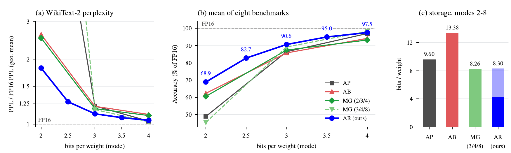
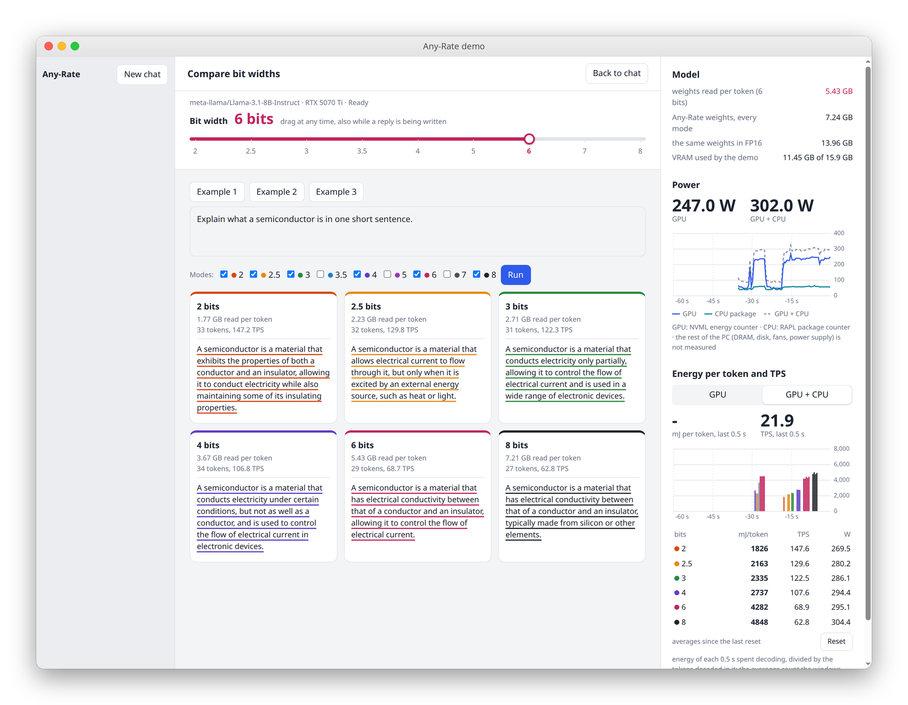

# Any-Rate: Half-Bit Multi-Precision LLM Quantization with Coded Bit-Planes [Preprint]

Official PyTorch implementation of **Any-Rate**.

[Paper https://arxiv.org/abs/2611.34402]

> **Note on collaboration.** This codebase was developed jointly by
> [Hoonki Lee](https://github.com/hoonki2002) and [Haechan Shin](https://github.com/hcvir).
> Please see the paper for the full author list and contributions.

<p align="center">
  
</p>

*Averages over Qwen2.5-3B, Gemma-3-4B-it, Llama-3.1-8B-Instruct and Phi-4: (a) WikiText-2 perplexity relative to FP16, (b) mean
accuracy on eight benchmarks relative to FP16. (c) Storage of one checkpoint that serves every mode from 2 to 8 bits
(Llama-3.1-8B-Instruct).*

**"A single Any-Rate checkpoint supports 9 precision modes (2, 2.5, 3, 3.5, 4, 5, 6, 7 and 8 bits)❗"**

## Installation

Requires Python 3.11 and PyTorch 2.11 or newer.

```
git clone https://github.com/hoonki2002/Any-Rate.git
cd Any-Rate
python -m venv .venv
source .venv/bin/activate
python -m pip install -r requirements.txt
python -m pip install --no-deps .
python -m any_rate.encode --help
```

## Any-Rate Encoding (or Download)

> 🤗 **Encoded checkpoints: All encoded models are on Hugging Face: [HoonkiLee/any-rate](https://huggingface.co/collections/HoonkiLee/any-rate).**

```
python -m any_rate.encode --model qwen2.5-3b
```

The original checkpoint is downloaded from the Hugging Face Hub, and the encoded checkpoint is written to `<original model name>-AR2to8`.

`--model`: `qwen2.5-3b`, `llama-3.1-8b-instruct`, `phi-4`, `gemma-3-4b-it`, `qwen3-30b-a3b-instruct-2507`, `whisper-large-v3`, `pixart-sigma`, `cogvideox-2b`

Details of the encoding (procedure, settings, calibration, options, checkpoint format): [any_rate/README.md](any_rate/README.md).

## Demo

```
bash kernels/build.sh
python demo/app.py          # then open http://127.0.0.1:7860
```

<p align="center">
  
</p>

> 🎬 **[Video (Llama-3.1-8B-Instruct)](https://youtu.be/8CPlP1yTaAo)**
>
> 🎬 **[Video (Qwen3-30B-A3B-Instruct-2507, MoE)](https://youtu.be/GEoNLIEH2nI)**

## [Optional] Encoding Baseline Methods

```
bash baselines/setup.sh
python -m baselines.matgptq.encode --model qwen2.5-3b --recipe 234
```

`setup.sh` clones the authors' code of Any-Precision LLM, AnyBCQ, MatGPTQ and GPTQ at the commits we used and applies small patches
(model support). The other commands are `python -m baselines.any_precision.encode`, `python -m baselines.anybcq.encode` and
`python -m baselines.gptq.encode` (single-precision GPTQ, one model per bit width).

Details of the baselines (recipes, models, patches, licenses, citations): [baselines/README.md](baselines/README.md).

## Evaluation

```
python -m evaluation --model qwen2.5-3b --method ar
```

Every mode of one method on one model, as in the paper: WikiText-2 perplexity and the eight benchmarks for the language models
(then the table), WER for Whisper, the images and the video for PixArt-Sigma and CogVideoX-2B.
`--method`: `ar`, `fp16`, `ap`, `ab`, `mg234`, `mg348`, `gptq` (Qwen3-30B-A3B also `ar_gate_mass`, `ar_reverse_gate_mass`).
Gemma-3 image descriptions: `--model gemma-3-4b-it --method ar --tasks vlm`.

## Paper Experiments

```
python -m experiments layout
python -m analysis
bash kernels/build.sh && bash baselines/setup.sh kernels
python -m kernels.bench && python -m kernels.tps
python -m moe allocation && python -m moe speed
```

`experiments`: the encoder design tables on Qwen2.5-3B, one command per table (`layout`, `ablation`, `residual`, `search`, `beam`, `weights`, or `custom`).
`analysis`: the layer-loss analysis of Section 4 and Appendix F, then every number of it.
`kernels`: the Any-Rate decode GEMV kernels, their latency against the authors' kernels of AP, AB and MG, and the decoding throughput of Llama-3.1-8B.
`moe`: the per-expert modes of Qwen3-30B-A3B by gate mass, and its decoding speed with a VRAM expert cache.

## Results

All numbers and outputs reported in the paper are in [results/](results/), one folder per appendix.

    results/A.Full_Benchmark_Results/                WikiText-2 perplexity and eight benchmarks of every method and bit width, with per-question outputs
    results/B.Comparison_with_Single-Precision_Quantization/   single-precision GPTQ at 2, 3 and 4 bits, with per-question outputs
    results/D.Method_Details/                        residual planes: storage of the 5-8-bit options and proxy loss of the 4-8-bit modes (Qwen2.5-3B)
    results/E.Encoder_Design_Choices/                layout, candidate search, beam width and mode weight comparisons (Qwen2.5-3B)
    results/F.Analysis_Details/                      layer-loss analysis of coded planes, error feedback and the nesting cost (Qwen2.5-3B)
    results/H.Storage_and_Decoding_Efficiency/       storage, kernel latency, decoding throughput and energy estimate of Llama-3.1-8B-Instruct
    results/I.Mixture-of-Experts_Model/              Qwen3-30B-A3B with experts encoded: accuracy, per-expert mode allocation, decoding speed
    results/J.Beyond_Language_Models/                vision-language, speech recognition, image and video generation outputs at each bit width

## Citation

@misc{lee2026anyrate,
  title = {Any-Rate: Half-Bit Multi-Precision LLM Quantization with Coded Bit-Planes},
  author = {Hoonki Lee and Haechan Shin and Hyuntaek Jung and Yeonu Choi and Sangyeob Kim},
  year = {2026},
  eprint = {2611.34402},
  archivePrefix = {arXiv},
  primaryClass = {cs.LG},
  url = {https://arxiv.org/abs/2611.34402}
}
